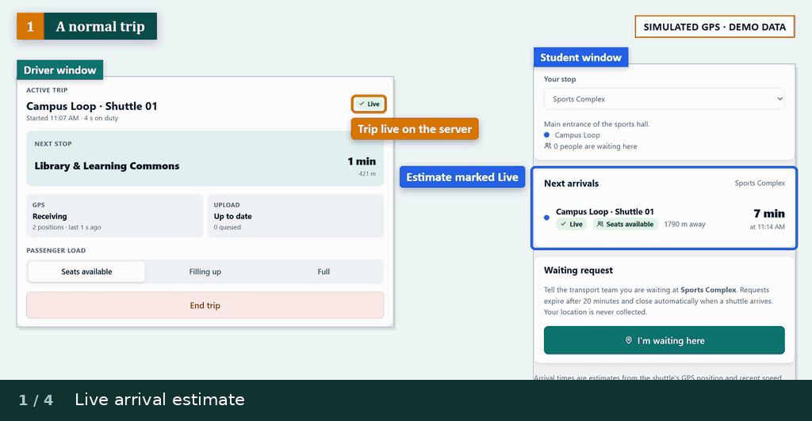
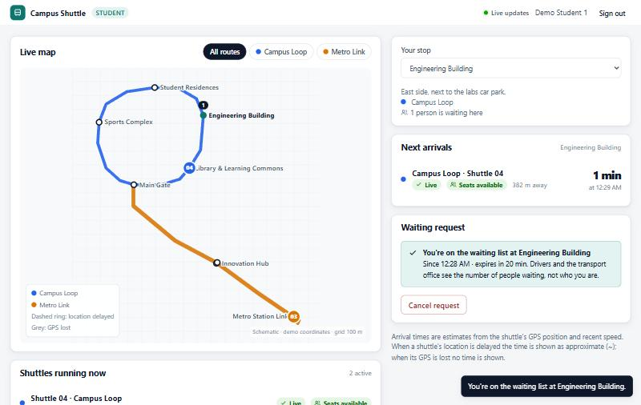
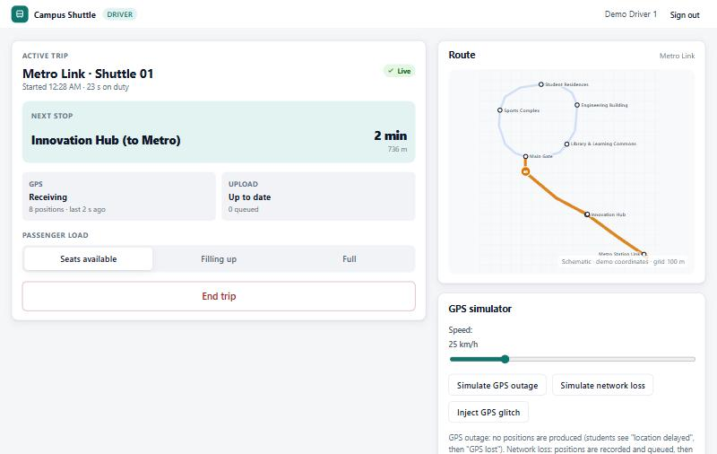
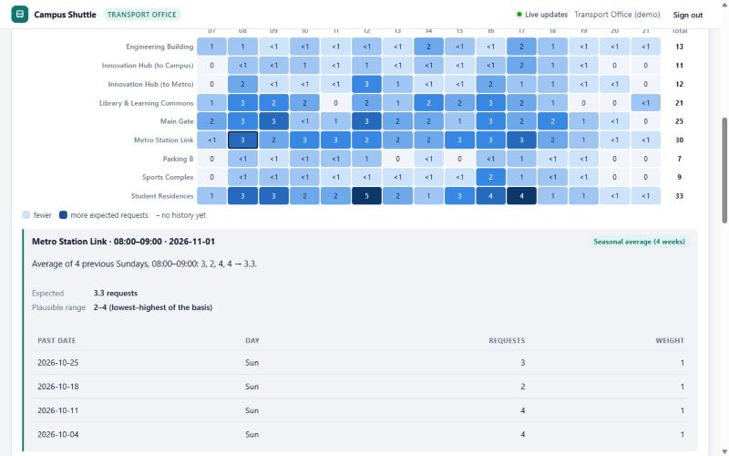

# Campus Shuttle Tracking & Demand Prediction

BCS 305 Software Architecture — course project prototype (Canadian University Dubai, Fall 2026).
Team: **Abdullah shammari** (`abdullahshammari796-ctrl`), **Zuhair Hussein Halawa** (`zuhairhalawa`), **Mubarak Al Khyeli** and **Ali Yosuf Ameer**. Zuhair and Abdullah did the implementation and technical integration. Mubarak and Ali took on the setup and forecast documentation and verification ([contribution statement](docs/team/contribution-statement.md)).

A locally runnable web system with three roles:

* **Students** see shuttles live on a campus map, get arrival estimates for their stop (clearly marked when a shuttle's location is delayed or lost), and can say "I'm waiting here".
* **Drivers** start and end trips and share their location — from the phone's GPS or a built-in **GPS simulator** — with offline buffering and recovery.
* **Transport-office staff** monitor the fleet and waiting demand live, end trips remotely (audited), manage routes, inspect trip GPS tracks, and view demand trends and **explainable forecasts** with a model backtest.

## Shuttle tracking in action

When a shuttle stops sending positions, the student sees a delayed estimate after 20 seconds. At 60 seconds the estimate disappears. A fresh position brings it back. The animation shows selected moments from the prototype using simulated GPS.



| Student arrivals | Driver trip controls | Office forecast explanation |
| --- | --- | --- |
| [](docs/presentation/screenshots/student.jpg) | [](docs/presentation/screenshots/driver.jpg) | [](docs/presentation/screenshots/office-explanation.jpg) |

> All routes, stops, vehicles, accounts and historical demand are **demonstration data**. The historical demand is **synthetic** and labelled as such everywhere; nothing here describes a real university's operations.

> **Prototype — do not deploy.** This is a course prototype, not a production system:
> * the demo accounts below have publicly known passwords;
> * HTTPS is not configured;
> * sessions expire but cannot be revoked early.
>
> Run it only on your own computer (the default address, `127.0.0.1`), or briefly on a private network for a demonstration. Never run it on a public or shared server, and never with the demo accounts. The server prints a warning whenever `HOST` makes it reachable from other devices.

## Quick start

Requirements: **Node.js 24 LTS** (≥ 22.18 works). No database server, no API keys, no internet connection needed at runtime.

```bash
npm install
npm start
```

Open <http://localhost:3000>. The first start creates `data/campus-shuttle.db` with demo data and 8 weeks of synthetic demand history.

### Demo accounts (local demonstration only)

| Role | Username | Password |
|---|---|---|
| Student | `student1`, `student2` | `student-demo` |
| Driver | `driver1`, `driver2`, `driver3` | `driver-demo` |
| Transport office | `office1` | `office-demo` |

These are defined in `src/seed/demo-data.ts`. They exist only in the local SQLite file that `npm start` / `npm run seed` creates, and they give access to nothing else. Never reuse these passwords anywhere, and never deploy the app with these accounts.

### A two-minute tour
1. In a second terminal run `npm run simulate -- --outage --outage-at 30` — two shuttles start driving (as `driver2`/`driver3`), and the Campus Loop shuttle loses GPS for 75 s, starting 30 s into every 4-minute cycle (the terminal prints the exact times).
2. Sign in as **student1**: watch the shuttles move, pick a stop, see the arrival list; tap *I'm waiting here*.
3. In a second window sign in as **driver1**, using `http://127.0.0.1:3000` so the session is separate (private windows of one browser share one session), start a trip with *Simulated GPS*; try *Simulate network loss* (then *End trip*: the trip is **not** ended while offline), *Simulate GPS outage* (students see "Location delayed" after ~20 s and "GPS lost" after ~60 s) and *Inject GPS glitch*.
4. In a third window at `http://office.localhost:3000` sign in as **office1**: live operations, *Demand & forecast* (click a heat-map cell for its explanation), *Routes*, *Trip history* (open a track), *System* (audit log).

The demo runbook, with timings and a failure fallback, is in [`docs/demo-script.md`](docs/demo-script.md); the slide-by-slide speaking script is in [`docs/presentation/speaking-script.md`](docs/presentation/speaking-script.md). Likely viva questions with evidence-based answers are in [`docs/presentation/viva-sheet.md`](docs/presentation/viva-sheet.md). The recorded demonstration video (4:11, with subtitles and a transcript) is not kept in Git because of its size; it is part of the submission folder, and the deck in this repository shows its poster frame.

## Scripts

| Command | What it does |
|---|---|
| `npm start` | Run the server (`HOST`, `PORT` configurable) |
| `npm run dev` | Run with auto-restart on file changes |
| `npm run seed` | Wipe the local database and re-create the demo data |
| `npm run simulate` | Headless fleet simulator (`-- --speed 40`, `-- --drivers 1`, `-- --outage [--outage-at 30 --outage-for 75]`) — needs a running server |
| `npm test` | All automated tests (unit, integration, real-time, architecture conformance) |
| `npm run typecheck` | TypeScript type check |
| `npm run test:browser` | Chromium browser tests in `e2e/` against a fresh in-memory server (first run once: `npx playwright install chromium`) |
| `npm run check` | Type check + tests |
| `npm run load-test` | Local fan-out benchmark (default 1,000 simulated viewers; `-- --viewers 3000 --rounds 10`). Viewers run in the server's process over loopback with one shared session and no browsers — not a deployment test |
| `npm run evaluate` | Reproducible backtest of the demand models on the synthetic history |
| `npm run uml` | Render `docs/uml/*.puml` to SVG/PNG and validate every export (needs Java + `PLANTUML_JAR`) |
| `npm run uml:check` | Check, without Java, that every committed SVG is well-formed XML, every PNG decodes completely, none is clipped, and all were rendered from the current sources |
| `npm run docs:build` | Build proposal, report and UML-set PDFs into `docs/build/` (uses Edge/Chrome headless) |
| `npm run review:package -- --task "Name" --notes <file>` | Build a verified review ZIP for the independent reviewer in `../review-packages/` (see CLAUDE.md) |

## Configuration (environment variables)

| Variable | Default | Meaning |
|---|---|---|
| `PORT` / `HOST` | `3000` / `127.0.0.1` | Listen address (`HOST=0.0.0.0` to allow other devices on your network) |
| `DB_FILE` | `data/campus-shuttle.db` | SQLite database file |
| `SESSION_SECRET` | generated into `data/session-secret` | Token signing key (≥ 32 chars) |
| `SECURE_COOKIES` | `false` | Set `true` when served over HTTPS |
| `STALE_AFTER_SECONDS` / `LOST_AFTER_SECONDS` | `20` / `60` | GPS freshness thresholds |
| `ABANDON_AFTER_MINUTES` | `30` | Auto-close a trip with no position for this long |
| `LOCATION_RETENTION_DAYS` | `30` | Delete raw GPS positions after this many days |
| `ETA_STRATEGY` | `blended-speed` | or `nominal-speed` |
| `SEED_ON_EMPTY` | `true` | Seed demo data when the database is empty |

Phone GPS in a browser requires HTTPS (or `localhost`). For demonstrations use the simulator.

## Architecture in one paragraph

A **modular monolith** (one Node.js process) whose components are folders under `src/` with explicit port interfaces: `web` (HTTP adapter, auth and role checks), `realtime` (Server-Sent Events gateway), `identity`, `network` (routes and route geometry), `tracking` (trips, GPS ingestion, ETAs, GPS-signal state machine), `demand` (waiting requests, forecasting, backtest), `persistence` (SQLite repositories) and `shared` (event bus, clock, geo). Components that react to each other communicate through domain events; `src/container.ts` is the only composition root. Patterns: Strategy (ETA, forecasting), Observer (event bus), State (GPS signal), Repository (persistence), Adapter (GPS sources). `test/architecture.test.ts` fails if the code's dependencies drift from the component diagram. Rationale and alternatives: report §6 and [`docs/adr/`](docs/adr/README.md).

```
src/
  main.ts, container.ts, config.ts   entry point, composition root, configuration
  shared/        event bus (Observer), clock, geo, errors, domain events
  identity/      users, password hashing, session tokens, auth service
  network/       routes, stops, shuttles, RoutePath (linear referencing)
  tracking/      trips, TripTracker, SignalState (State), ETA strategies (Strategy), TrackingService
  demand/        waiting requests, HourlySeries, predictors (Strategy), backtest, DemandService
  realtime/      SseHub (Server-Sent Events), LiveView
  persistence/   SQLite schema/migrations, repositories (Repository), in-memory repositories for tests
  web/           Express app, middleware, route modules per role
  seed/          demo network/accounts, synthetic demand generator
public/          student.html, driver.html, office.html, css/, js/ (map, live feed, GPS adapters, charts)
scripts/         seed, fleet simulator, load test, demand evaluation, UML render, PDF build
test/            unit/, integration/, architecture.test.ts
docs/            proposal, report, UML set, ADRs, QA scenarios, test plan, privacy, demand, team, presentation
```

## Documentation

| Document | Path |
|---|---|
| Requirements traceability (what is done / outstanding) | [`docs/00-requirements-traceability.md`](docs/00-requirements-traceability.md) |
| One-page proposal | [`docs/01-proposal.md`](docs/01-proposal.md) |
| Project report (sections 1–10) | [`docs/02-project-report.md`](docs/02-project-report.md) |
| UML diagram set + use-case descriptions | [`docs/03-uml-diagram-set.md`](docs/03-uml-diagram-set.md), sources in [`docs/uml/`](docs/uml) |
| Architecture decision records | [`docs/adr/`](docs/adr/README.md) |
| Quality-attribute scenarios | [`docs/architecture/quality-attribute-scenarios.md`](docs/architecture/quality-attribute-scenarios.md) |
| Technical assessment of options A–D and the ADRs | [`docs/architecture/technical-assessment.md`](docs/architecture/technical-assessment.md) |
| Test plan and results | [`docs/test-plan.md`](docs/test-plan.md), raw outputs in [`docs/evidence/`](docs/evidence) |
| Demand prediction | [`docs/demand-prediction.md`](docs/demand-prediction.md) |
| Privacy and security | [`docs/privacy-and-security.md`](docs/privacy-and-security.md) |
| Demo runbook / presentation and speaking script | [`docs/demo-script.md`](docs/demo-script.md), [`docs/presentation/`](docs/presentation) |
| Team: ownership plan, contribution statement, AI-use statement | [`docs/team/`](docs/team) |

### Rendering the UML diagrams
The diagrams are PlantUML sources (standard UML notation, editable text). They were compared with the code member by member and rendered on 2 November 2026 (diagram 10 again on 7 November, after a label fix); the exports are committed in `docs/uml/out/` with a `manifest.json`. To render them again on any machine with Java 11+ (Graphviz is not needed; the diagrams use the built-in *smetana* layout):

1. Download `plantuml-mit-1.2026.9.jar` from Maven Central: `https://repo1.maven.org/maven2/net/sourceforge/plantuml/plantuml-mit/1.2026.9/`. This is the MIT-licensed build, so no installer and no admin rights are needed.
2. Verify it before running it. The SHA-256 published next to the jar (`.jar.sha256`) is `e84e45b37ad3030cf802e7be18a687d209eca55733a5679b1f1f1a515f7f70dd`. Check it with `Get-FileHash -Algorithm SHA256 <jar>` on Windows or `sha256sum <jar>` elsewhere.
3. Render: `PLANTUML_JAR=<path to jar> npm run uml`. Optionally add `JAVA=<path to java>`; on Windows use `$env:PLANTUML_JAR='…'` first. The script refuses a jar whose SHA-256 differs. It renders into a fresh temporary folder with `PLANTUML_LIMIT_SIZE=8192`, because the default 4096 px clips the large class diagrams, and stops at the first syntax error. It replaces `docs/uml/out/` only if every SVG parses as well-formed XML (with `@xmldom/xmldom`; any parser error or warning rejects the file) and every PNG decodes completely, and each PNG matches its SVG's size. PNG decoding covers chunk order and CRCs, the exact pixel-data length, every scanline filter and every palette index. Only the 8-bit, non-interlaced PNGs that PlantUML writes are accepted; other encodings are rejected rather than skipped. It then records the source and export hashes in `manifest.json`. A hash only records bytes, so exports are validated again before they are recorded and every time they are checked.
4. Look at every SVG and fix what is wrong. If a diagram with packages or composite states fails under smetana, remove its `!pragma layout smetana` line and install Graphviz instead.
5. Run `npm run docs:build` to embed the SVGs in the report and UML-set PDFs. It embeds only exports that pass `npm run uml:check`, which CI also runs. A stale, missing, empty, corrupt or clipped export becomes a red placeholder that names the problem. No diagram is printed below 60 % of its rendered size: larger ones get an overview page plus overlapping detail pages, on landscape pages where that helps.

IDE exports (JetBrains *PlantUML Integration*, VS Code *PlantUML*) are fine for looking at a diagram. They are not recorded in `manifest.json`, so `npm run uml:check` and the PDF build treat them as unverified until `npm run uml` renders them.

## Status and limitations
See report §8.2 and the traceability checklist. In short: device GPS has not been field-tested on a vehicle; HTTPS and single sign-on are not set up; sessions expire after 8 h (open live streams are closed then) but cannot be revoked early; the driver's offline queue is bounded and lives only in the open page (QA-4); load figures come from a local benchmark, not a deployment test; forecasts are demonstrated on synthetic data only; UI code is verified manually (no automated browser tests); diagrams await rendering; personal sections of the report (reflection, contribution, AI-use "what we changed") must be written by the team.

## Independent review packages
After every task a ZIP of the whole project (sources, tests, docs, diagrams, PDFs, slides, evidence) is created for an independent reviewer with `npm run review:package`. It runs the type check and tests and reports them as PASSED, FAILED or NOT RUN, never as passed when skipped. It scans the project files and everything it generates (summary, notes, logs, Git metadata) for secrets and personal data, after redacting known local secrets from generated text. It excludes `node_modules`, `.git`, `data/` and any `.env`, and writes `REVIEW_SUMMARY.md`, a SHA-256 inventory and a verification report. Archives go to the sibling folder `../review-packages/`, never into the project. The procedure is in [`CLAUDE.md`](CLAUDE.md); configuration placeholders are in [`.env.example`](.env.example).

## Repository and team workflow
Public repository: <https://github.com/abdullahshammari796-ctrl/CampusShuttle>. Owner: Abdullah; collaborator: Zuhair Halawa.
* `main` holds the reviewed state. Every change is made on its own branch (e.g. `abdullah/uml-rendering`) and merged through a pull request that the **other** team member reviews. Branch protection enforces this: merging into `main` needs 1 approving review and a passing `verify` check, also for the owner; force pushes and deletion are blocked.
* Work items are GitHub issues labelled `owner: Abdullah`, `owner: Zuhair` or `owner: both`; the split is explained in [`docs/team/work-ownership-plan.md`](docs/team/work-ownership-plan.md).
* Commits are authored by the person who did the work. The initial import commit contains the project baseline; it does not represent either student's individual contribution. How the work was produced, including the tools used, is declared in [`docs/team/ai-use-statement.md`](docs/team/ai-use-statement.md), as the project description requires.

## Licence
No licence has been chosen yet, so default copyright applies. Others can view and fork the repository on GitHub under GitHub's terms of service, but no other rights to reuse the code or documents are granted. The team will decide whether to add an open-source licence.


### Automated browser checks

Use Node 24. Install locked dependencies with `npm ci`, then install the test browser once with `npx playwright install chromium` (Linux CI: `npx playwright install --with-deps chromium`). Run `npm run test:browser`. The suite starts an isolated in-memory application on an unused loopback port for each test and never resets your demo database. `npm test` still runs the unit/integration/architecture suite. `npm run typecheck` also checks the browser test sources.

An optional `PLAYWRIGHT_CHROMIUM_EXECUTABLE_PATH` selects an already-installed Chromium binary in restricted runners; leave it unset for the bundled Playwright browser. Failure traces/screenshots in `test-results/` stay local and are excluded from Git and review packages.

### Continuous verification

`.github/workflows/verify.yml` runs type checking, unit/integration tests, Chromium browser tests, synthetic evaluation and a production-dependency audit on PRs to `main` and branch pushes. It uses Node 24, read-only repository permissions, pinned official actions and no deployment steps. Fork PR runs may need the repository owner's normal GitHub approval. A successful local test run is not a GitHub Actions pass; inspect the actual run before merging.
