# Appendix A — UML diagram set

**Campus Shuttle Tracking & Demand Prediction** · BCS 305 Software Architecture · Fall 2026

All diagrams are drawn with **PlantUML** (a text-based UML tool) using standard UML 2 notation. The editable sources are in `docs/uml/*.puml`; rendered SVG/PNG files go to `docs/uml/out/` (`npm run uml`). The class, component and sequence diagrams were written from the actual source code and were compared with it member by member on 1 November 2026 (corrections are listed in `docs/test-plan.md` §4). They were compared again in the owner review after PRs #12 and #13, which corrected diagrams 02, 04, 05, 07–12, 14 and 16 (`docs/test-plan.md` §4, item 13). **The diagrams have not yet been rendered by a real renderer** (issue #1), so syntax and layout are unverified. Only one aspect is checked automatically: `test/architecture.test.ts` fails if a source file imports a component that the component diagram does not allow. It does **not** check UML operations, attributes, associations, multiplicities or sequence messages; those were reviewed by hand and can drift when the code changes. Where a diagram writes a type as `{…}`, the code uses an inline TypeScript object type with no class name.

| # | Diagram | Required by the brief | Source file |
|---|---|---|---|
| A.1 | Use case diagram | Yes | `01-use-case-diagram.puml` |
| A.2 | Use case descriptions (5 primary use cases) | Yes (≥ 3) | this document |
| A.3 | Activity diagram — Run a trip | Yes | `02-activity-run-trip.puml` |
| A.4 | System sequence diagram — Run a trip and track it | Yes | `03-system-sequence-diagram.puml` |
| A.5 | Design sequence diagram — processing a location upload | Extra | `04-sequence-location-update.puml` |
| A.6 | State machine — Trip and GPS signal | "Where relevant" | `05-state-machine-trip.puml` |
| A.7 | State machine — Waiting request | "Where relevant" | `06-state-machine-waiting-request.puml` |
| A.8 | Domain model (conceptual class diagram) | Yes | `07-domain-model.puml` |
| A.9 | Design class diagram 1/2 — tracking, network, real-time | Yes | `08-class-diagram-tracking.puml` |
| A.10 | Design class diagram 2/2 — demand, forecasting, identity | Yes | `09-class-diagram-demand-identity.puml` |
| A.11 | Component diagram | Yes | `10-component-diagram.puml` |
| A.12 | Deployment diagram | Yes | `11-deployment-diagram.puml` |
| A.13–A.17 | Design pattern class diagrams (Strategy, Observer, State, Repository, Adapter) | Yes (≥ 3 patterns) | `12`–`16-pattern-*.puml` |

## A.1 Use case diagram

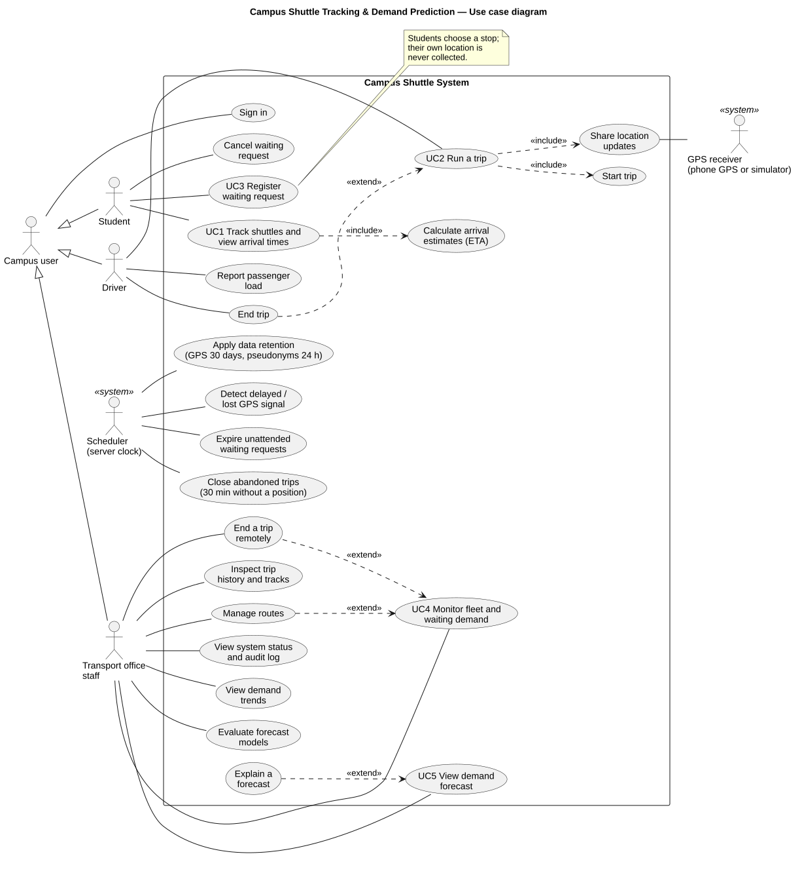

Three primary human actors (Student, Driver, Transport office staff) share a generalised *Campus user* actor for sign-in. Two system actors appear as secondary actors: the **GPS receiver** (the phone's GPS or the built-in simulator) and the **Scheduler** (the server clock that detects stale GPS and expires waiting requests). `«include»` marks behaviour that always happens as part of a use case; `«extend»` marks optional behaviour.

## A.2 Use case descriptions

The five primary use cases below are all implemented end to end in the prototype. UC1 and UC2 together form the main demonstration scenario.

### UC1 — Track shuttles and view arrival times

| Field | Description |
|---|---|
| Primary actor | Student |
| Stakeholders and interests | Student: wants to know whether to walk to the stop now, without waiting in the heat. Transport office: fewer phone calls asking "where is the bus?". Driver: wants passengers ready at the stop. |
| Preconditions | Student is signed in. At least one route is in service. |
| Trigger | Student opens the student page. |
| Main success scenario | 1. System shows the schematic map with routes, stops and every active shuttle, and opens a live feed. 2. Student selects a stop (on the map or from a list; the choice is remembered on that device). 3. System lists every shuttle on a route serving that stop, soonest first, with the estimated minutes, clock time, distance, passenger load and a live-signal badge. 4. As drivers send positions, the system pushes updates; positions and minutes change without reloading. 5. When a shuttle on a loop route reaches the selected stop, its next-lap estimate is recalculated and the list is sorted again. A non-loop route does not invent a next lap. |
| Extensions | 3a. No shuttle is running on a route serving the stop: system says so plainly. 4a. A shuttle's newest position is more than 20 s old: its estimate is shown as approximate ("~6 min") with "location delayed"; when the estimate time has passed it shows "Due". 4b. No position for more than 60 s: the system shows "GPS signal lost · last seen N min ago" and **no estimate**. 4c. The student's connection drops: a banner says "reconnecting — times may be out of date"; on reconnection a full snapshot replaces the old state. 4d. Session expired: banner offers to sign in again. |
| Postconditions | None (read-only use case). |
| Quality attributes | Freshness (QA-1), scalability with many viewers (QA-2), honesty under GPS loss (QA-3), privacy: no driver identity is ever sent to students (QA-6). |
| Implemented in | `public/js/student.js`, `src/web/routes/shared-routes.ts`, `src/realtime/sse-hub.ts`, `src/tracking/tracking-service.ts` |

### UC2 — Run a trip (start, share location, end)

| Field | Description |
|---|---|
| Primary actor | Driver. Secondary actor: GPS receiver (device GPS or simulator). |
| Stakeholders and interests | Driver: minimal interaction while working. Students: accurate positions. Office: knows which vehicle is on which route and who is accountable. |
| Preconditions | Driver is signed in, has no other active trip, and the chosen shuttle is free. |
| Trigger | Driver taps "Start trip" after choosing route, shuttle and location source. |
| Main success scenario | 1. System validates the route is in service and that the shuttle and driver are free, then creates an ACTIVE trip (signal "awaiting first GPS position") and announces it to all viewers. 2. Driver app starts the GPS source. 3. The simulator obtains a position every ~3 s (device GPS is event-driven and throttled to at most one fix per 2 s) and uploads all queued positions in one batch with the device's current time. 4. System corrects device clock skew, validates and orders the positions, stores them, snaps the shuttle onto the route, updates its smoothed speed, recalculates ETAs, detects stops reached, and pushes one update to all viewers. 5. App shows "what passengers see" (Live / Delayed / GPS lost) and the next stop. 6. Driver optionally sets passenger load (seats available / filling up / full). 7. Driver taps "End trip" and confirms; the app first delivers the queued positions (waiting at most 5 s), holds new ones and sends the end request; the system completes the trip and removes the shuttle from every map; only after the server confirms does the app stop GPS and show "Trip ended". |
| Extensions | 1a. Shuttle or driver already on an active trip, or route out of service: system refuses with the reason (HTTP 409; an unknown route or shuttle gives 404). 3a. GPS produces no positions (tunnel, outage): nothing is uploaded; students see the delayed → lost sequence (UC1 4a–4b). 3b. Network unavailable: positions stay queued in the open driver page (newest 500 kept; older ones dropped and counted; lost if the page is closed or reloaded) and are retried with exponential backoff (1 s → 15 s); when the network returns they are delivered in batches of up to 50 and the shuttle jumps to its true position; positions more than 10 minutes old on arrival are rejected. 4a. A position is duplicated, out of order, physically impossible (> 110 km/h jump), too inaccurate (> 150 m), too old (> 10 min) or outside the service area: it is rejected with a reason code and the rest of the batch is still accepted. 4b. The page is reloaded: the trip resumes from the server's last known position with the same location source as its latest accepted position (device GPS or simulator). If no position has been accepted yet, the app shares nothing until the driver chooses a source. 7a. The office ended the trip remotely (UC4): the next upload returns 409/404 and the app returns to the start screen with an explanation. 7b. No accepted position for 30 minutes (counted from the last position, or from the trip start if there was none): the system closes the trip automatically (TERMINATED, reason NO_SIGNAL_TIMEOUT). 7c. The end request fails (no network, expired session, server unreachable): the trip stays ACTIVE, location sharing continues, the app says the trip was **not** ended and the driver can try again; if the server answers that the trip had already ended (409/404), the app treats it as ended. |
| Postconditions | The trip is COMPLETED or TERMINATED, with its GPS trace stored (deleted after 30 days). |
| Implemented in | `public/js/driver.js`, `public/js/gps.js`, `src/web/routes/driver-routes.ts`, `src/tracking/*` |

### UC3 — Register a waiting request ("I'm waiting here")

| Field | Description |
|---|---|
| Primary actor | Student |
| Stakeholders and interests | Student: wants the shuttle to know someone is waiting. Office: real-time demand signal and history for forecasts. Privacy officer: no tracking of individual students. |
| Preconditions | Student is signed in and has selected a stop. |
| Main success scenario | 1. Student taps "I'm waiting here", optionally choosing a specific route. 2. System records the request against a **pseudonymous reference** (keyed hash of the user id), sets a 20-minute expiry, and pushes the stop's new waiting count to all viewers. 3. The student sees "You're on the waiting list at Library · expires in 20 min". 4. When a shuttle on a matching route reaches the stop, the system marks the request SERVED and the student sees "A shuttle reached Library at 08:14". |
| Extensions | 1a. Same stop and route requested again: the existing request is returned (idempotent). 1b. Different stop or route: the previous request is cancelled and replaced. 1c. Route does not serve the stop: rejected with a reason. 1d. More than 6 requests in an hour: rejected (429) to prevent abuse that would distort demand data. 3a. Student cancels: request CANCELLED and the count updates. The open page reconciles its private request after a matching waiting-count event and after a reconnect snapshot, including closures missed while offline. 4a. No shuttle within 20 minutes: request EXPIRED. |
| Postconditions | Request closed in one of SERVED / CANCELLED / EXPIRED; 24 h later its pseudonymous link is erased and it remains only as anonymous demand data. |
| Implemented in | `src/demand/waiting-service.ts`, `src/web/routes/student-routes.ts`, `public/js/student.js` |

### UC4 — Monitor the fleet and waiting demand (with remote trip termination)

| Field | Description |
|---|---|
| Primary actor | Transport office staff |
| Preconditions | Staff member signed in with the office role. |
| Main success scenario | 1. System shows KPI tiles (shuttles on trip, GPS problems, students waiting, live viewers), the fleet map with waiting badges, waiting counts per stop, and a table of active trips including the accountable driver, GPS state, last position age, load and next-stop ETA — all updated live. 2. Staff opens a trip's track to inspect its GPS trace: positions, distance, duration, longest gap and number of gaps longer than the stale threshold. |
| Extensions | 1a. *End a trip remotely* («extend»): staff chooses "End", must give a reason; the system terminates the trip, records actor, time and reason in the audit log, and the driver app is told on its next contact. 1b. *Manage routes*: take a route out of service or back, edit name/colour/planned speed/dwell time, or create a new route from an ordered list of stops (created inactive for review). Every change is audited. |
| Implemented in | `public/js/office.js`, `src/web/routes/office-routes.ts`, `src/network/network-service.ts` |

### UC5 — View the demand forecast (with explanation)

| Field | Description |
|---|---|
| Primary actor | Transport office staff |
| Main success scenario | 1. Staff opens "Demand & forecast", picks a date and a model. 2. System shows the expected requests per hour (all stops), a stop × hour heat map, the peak hour and busiest stop, and states which data sources were used (synthetic and/or live). 3. Staff selects a cell; the system explains it: method, the exact past observations used (dates, counts, weights) and the plausible range. 4. Staff compares models in the backtest table (MAE, RMSE, bias, range coverage). |
| Extensions | 2a. Not enough history for a stop-hour: the cell shows "–" and **no number is invented**. 2b. History contains synthetic data: a warning banner states that the figures illustrate the method only. |
| Implemented in | `src/demand/demand-service.ts`, `src/demand/prediction/*`, `public/js/office.js` |

## A.3 Activity diagram — Run a trip

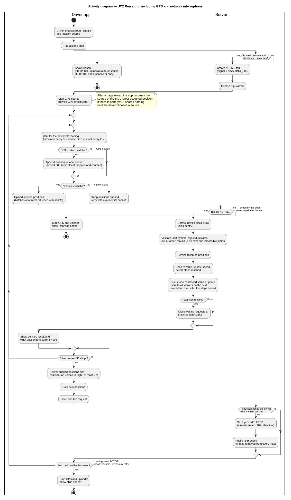

Swimlanes separate the driver app from the server. The two interruption paths are visible: *GPS outage* (no position is appended to the queue) and *network loss* (the queue is kept and retried with backoff). Two further paths are shown: the server ending the trip while it runs (office or 30-minute auto-close), and ending the trip, where the outer loop repeats until the server confirms the end, so a failed request leaves the trip active.

## A.4 System sequence diagram — Run a trip and track it

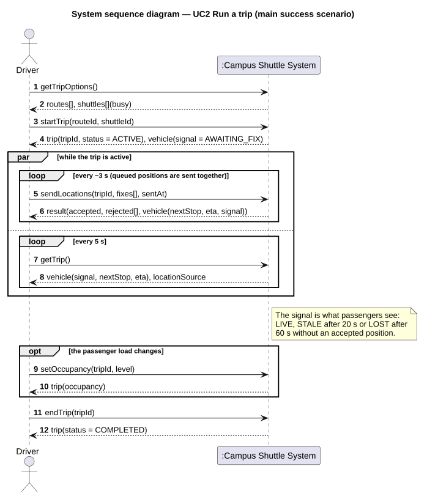

The system is a black box; messages are the system operations of the REST API and the live feed. The `opt` fragments are system-initiated (time) events.

## A.5 Design sequence diagram — processing one location upload

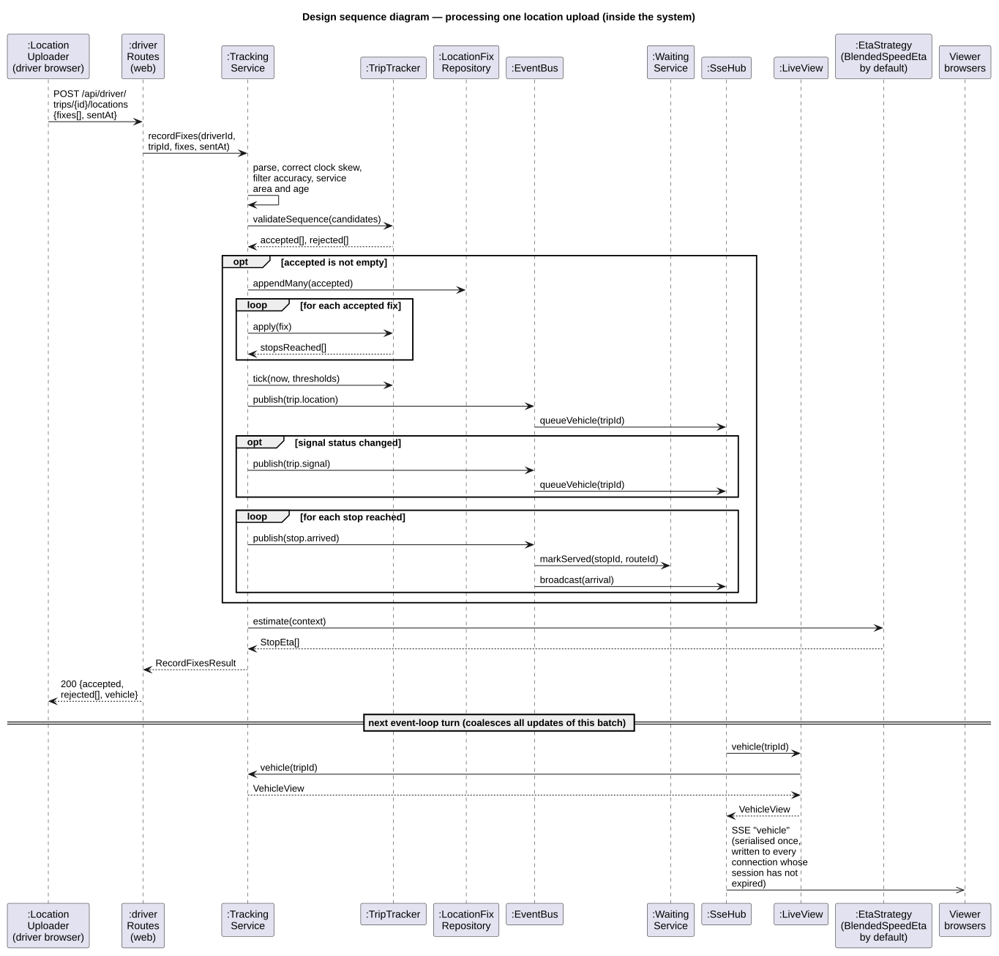

## A.6 State machine — Trip and GPS signal

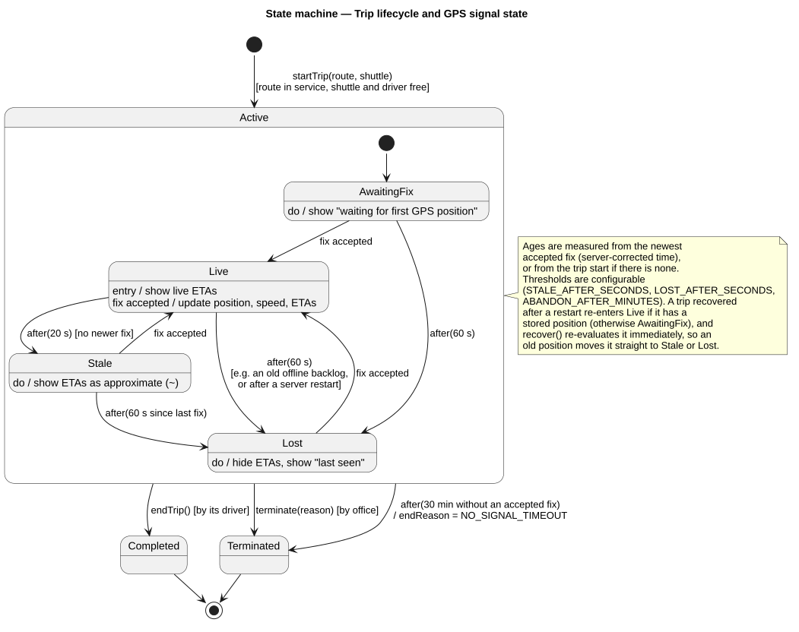

`Active` is a composite state; its sub-states are implemented one-to-one by the State pattern classes in `src/tracking/signal-state.ts` (Figure A.15). Time events use UML `after(...)` notation.

## A.7 State machine — Waiting request

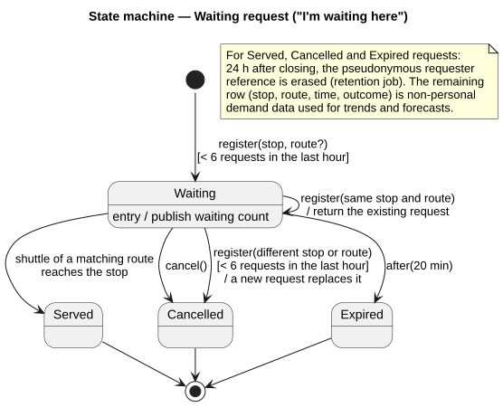

## A.8 Domain model

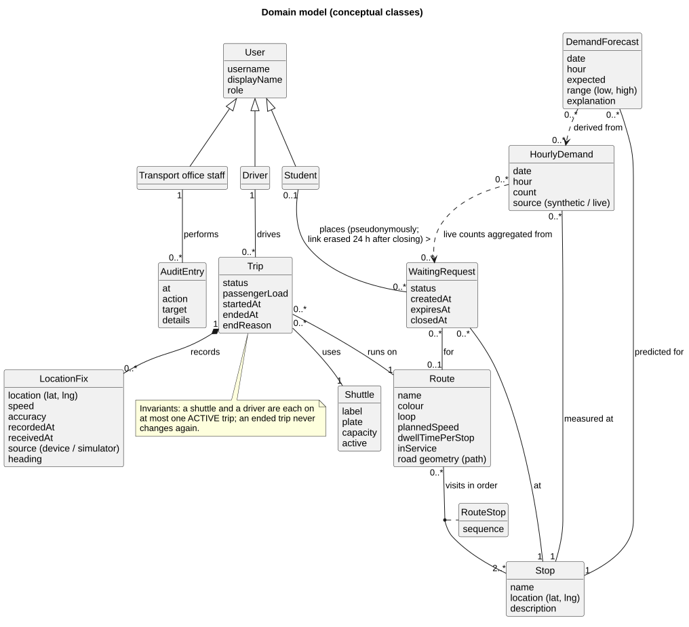

Conceptual classes only (no operations). `RouteStop` is an association class carrying the stop order of a route.

## A.9 Design class diagram 1 of 2 — tracking, network, real-time

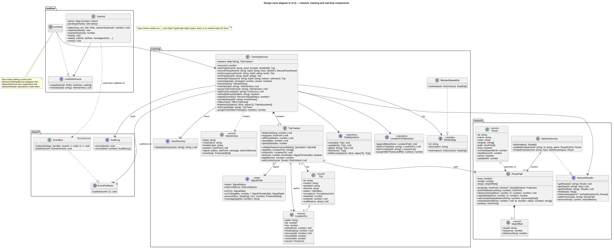

## A.10 Design class diagram 2 of 2 — demand, forecasting, identity

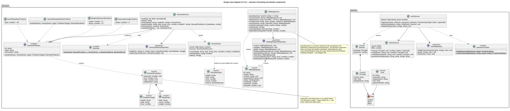

## A.11 Component diagram

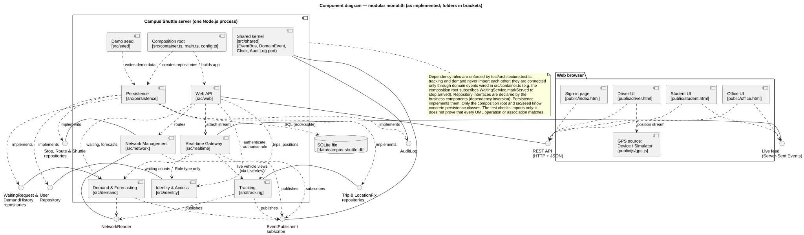

Each component is a folder under `src/` with a public service class and port interfaces. Provided interfaces are drawn as lollipops, required ones as dependencies on them.

## A.12 Deployment diagram

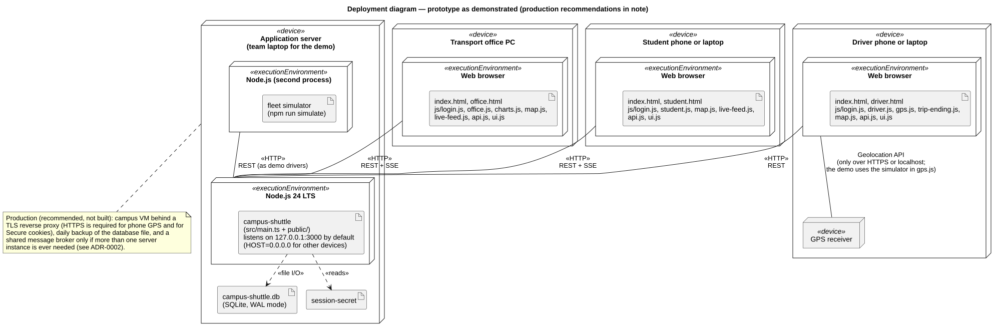

## A.13–A.17 Design pattern class diagrams

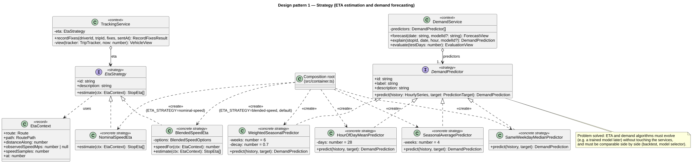

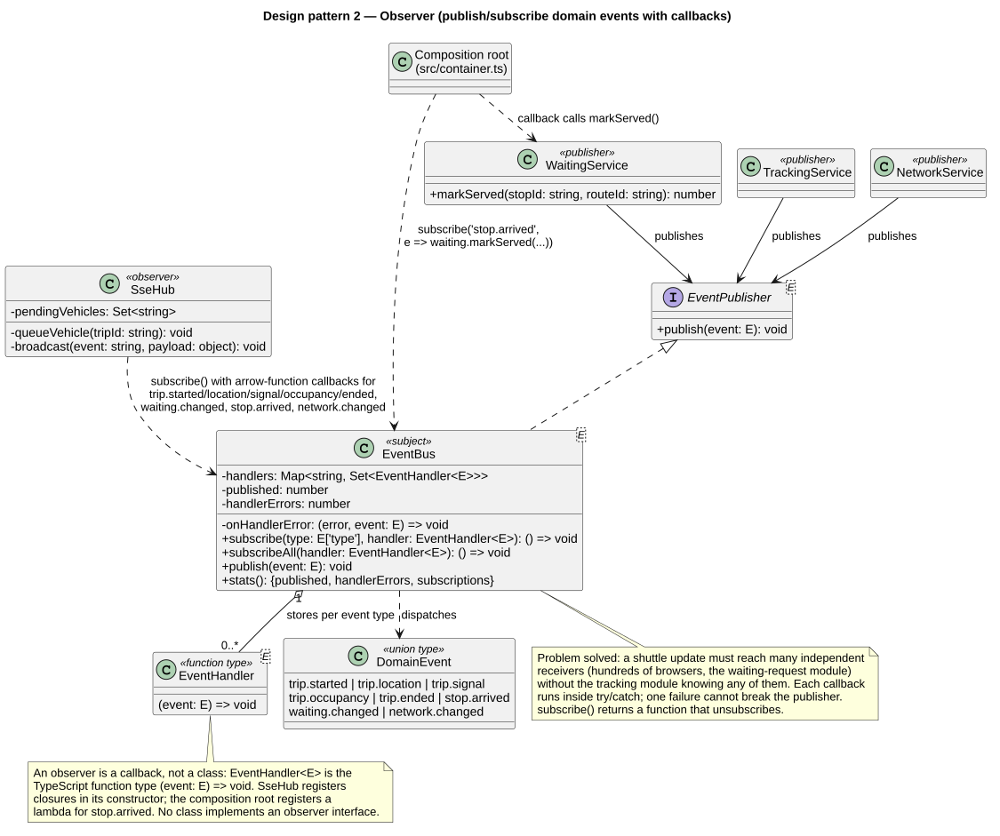

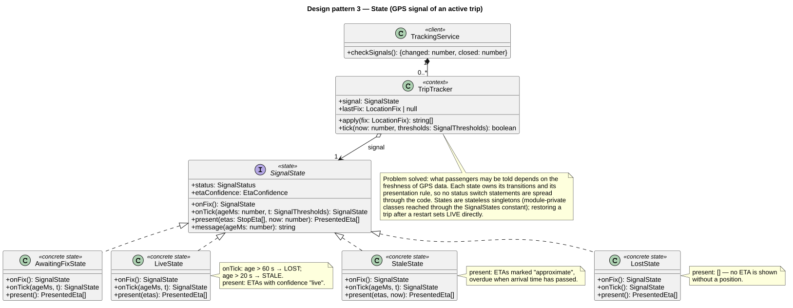

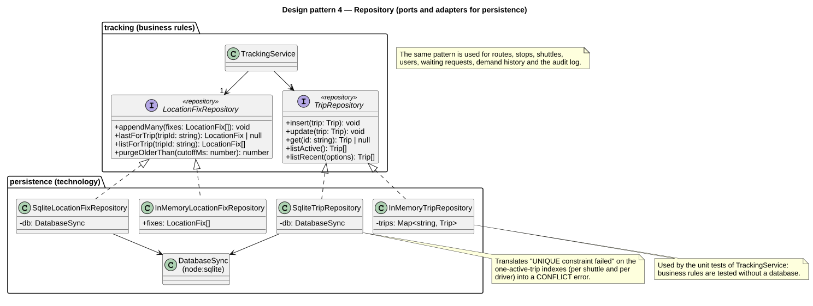

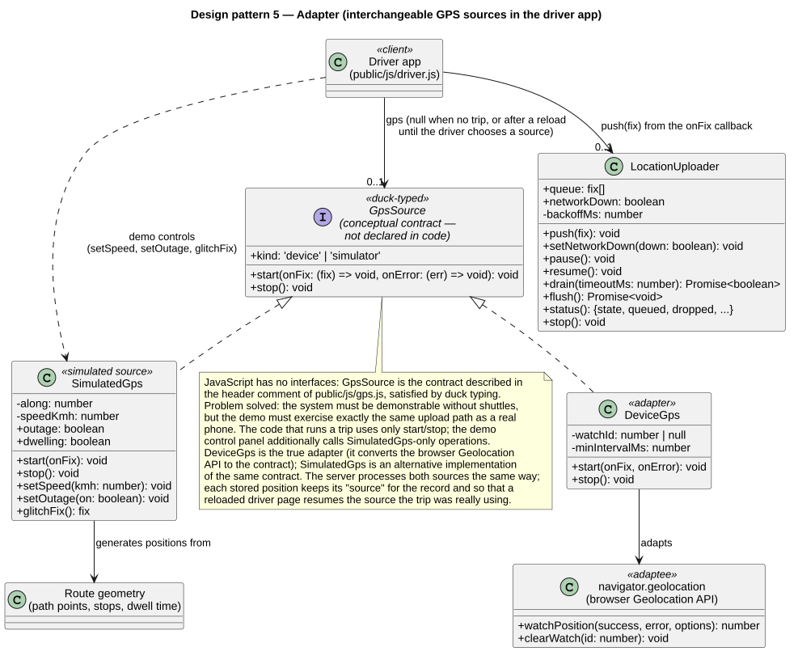
